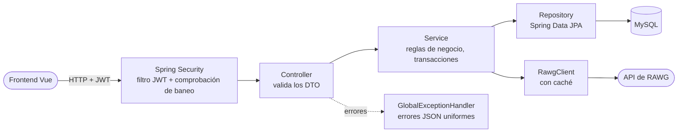
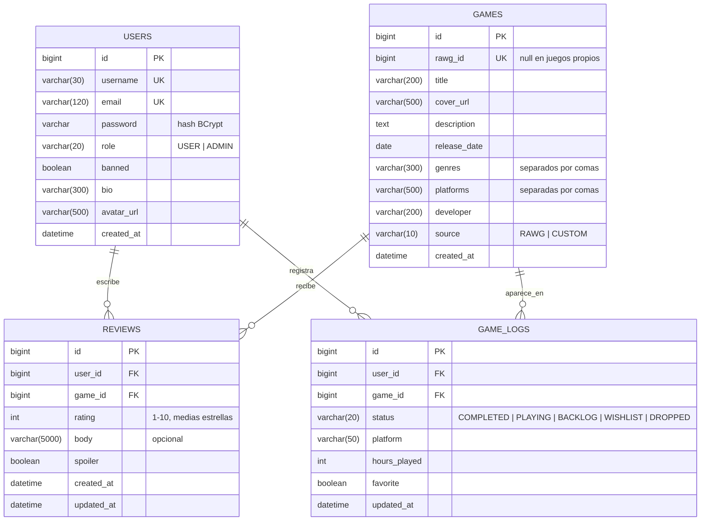
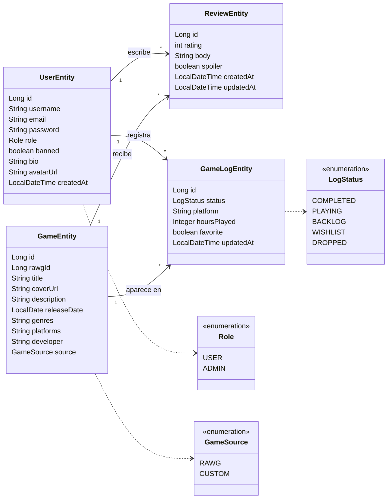
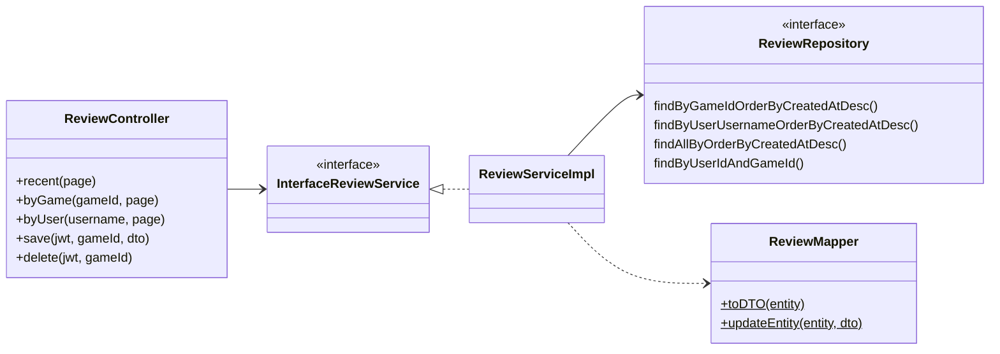

# GameTracker · Backend

API REST de **GameTracker**, un diario de videojuegos al estilo de Letterboxd: registra los juegos a los que juegas, puntúalos con medias estrellas, escribe reseñas y descubre a qué está jugando la comunidad.

Construida con **Spring Boot 4** y **Java 21**, protegida con **Spring Security + JWT**, con persistencia en **MySQL 8.4 (Docker)** y datos reales de juegos de la **API de [RAWG](https://rawg.io)**.

| | |
|---|---|
| Repositorio del frontend | [joseang1/gametracker-frontend](https://github.com/joseang1/gametracker-frontend) |
| Presentación | [Google Slides](https://docs.google.com/presentation/d/1277NM0ZelXjq1SDd6KdOjriDDdf-gMp35FVzrf0wXks/edit?usp=sharing) |
| Tablero del proyecto | JIRA · 3 sprints (backend, frontend, documentación y entrega) |

---

## Índice

1. [Funcionalidades](#funcionalidades)
2. [Stack tecnológico](#stack-tecnológico)
3. [Arquitectura](#arquitectura)
4. [Diagramas](#diagramas)
5. [Puesta en marcha](#puesta-en-marcha)
6. [Referencia de la API](#referencia-de-la-api)
7. [Seguridad](#seguridad)
8. [Testing](#testing)
9. [Metodología de trabajo](#metodología-de-trabajo)

---

## Funcionalidades

| Rol | Qué puede hacer |
|---|---|
| **Invitado** | Explorar y buscar en el catálogo, ver los juegos en tendencia, leer las fichas de los juegos, las reseñas y los perfiles públicos |
| **Usuario** | Todo lo que puede un invitado, y además: registrar juegos con un estado (jugando, completado, pendiente, lista de deseos, abandonado), plataforma, horas y favorito; puntuar (de 1 a 10, mostrado como medias estrellas) y reseñar juegos con aviso de spoilers; editar su perfil |
| **Admin** | Todo lo que puede un usuario, y además: estadísticas del sitio, banear y desbanear jugadores, borrar reseñas, crear, editar y borrar juegos |

Los datos de los juegos vienen de RAWG. El backend **hace de intermediario y guarda en caché** las respuestas de RAWG, e importa un juego a su propia base de datos la primera vez que alguien lo abre, de modo que las reseñas y los registros siempre apuntan a nuestros propios ids.

---

## Stack tecnológico

| Área | Tecnología |
|---|---|
| Lenguaje / framework | Java 21 · Spring Boot 4.1 (Web MVC, Data JPA, Validation, Cache, Actuator) |
| Seguridad | Spring Security · OAuth2 Resource Server (JWT, HS256) · BCrypt |
| Base de datos | MySQL 8.4 con Docker Compose · perfil H2 en memoria para pruebas rápidas |
| API externa | RAWG Video Games Database (`RestClient` de Spring + caché en memoria) |
| Tests | JUnit 5 · Mockito · Hamcrest · MockMvc (`@WebMvcTest`) · `@DataJpaTest` · Testcontainers (MySQL) · `MockRestServiceServer` |
| Build | Maven Wrapper |

---

## Arquitectura

El código está organizado **por funcionalidad**. Cada funcionalidad tiene su propio controller, service (interfaz + implementación), repository, entidad, DTO, mapper y excepciones.

```
com.josedev.gametracker
├── auth       registro, login, usuario actual
├── user       perfiles, entidad de usuario y roles
├── game       catálogo, tendencias, importación de RAWG, CRUD de admin
│   └── rawg   cliente de RAWG y sus DTO
├── review     reseñas y puntuaciones
├── gamelog    biblioteca personal (estado, plataforma, horas, favorito)
├── admin      estadísticas y moderación
├── security   creación de JWT, comprobación de baneo, búsqueda de usuario
├── config     seguridad, JWT, RAWG, datos iniciales
└── globals    handler global de excepciones, excepción base, DTO de página
```

Todas las peticiones siguen el mismo camino:



- **DTO como records de Java** (`XDTORequest` / `XDTOResponse`) con validación de Jakarta. Las entidades nunca salen del backend.
- **Mappers estáticos** (`toEntity` / `toDTO`) convierten entre DTO y entidades.
- **Errores:** cada funcionalidad lanza su propia excepción que extiende `ApiException`, que lleva un código HTTP. `GlobalExceptionHandler` las convierte en `{ status, message, errors, timestamp }`, con un mensaje por cada campo inválido en los errores de validación.

---

## Diagramas

### Base de datos (entidad-relación)



`reviews` y `game_logs` tienen cada una una restricción **unique (user_id, game_id)**: una reseña y un registro por juego y usuario. Si se vuelve a guardar, se actualiza la fila existente.

### Clases del dominio



### Capas de una funcionalidad (ejemplo: reseñas)



---

## Puesta en marcha

### Requisitos

- **Java 21**
- **Docker Desktop** (para MySQL y para los tests de integración)
- Una **API key de RAWG** gratuita: regístrate en [rawg.io/apidocs](https://rawg.io/apidocs)

### 1. Clonar y configurar

```bash
git clone https://github.com/joseang1/gametracker-backend.git
cd gametracker-backend
cp .env.example .env
```

Abre `.env` y pega tu clave:

```
RAWG_API_KEY=tu_clave_aqui
```

`.env` está ignorado por git. Spring lo carga automáticamente mediante `spring.config.import=optional:file:.env[.properties]`.

### 2. Arrancar

**Con MySQL (por defecto).** Abre Docker Desktop y después:

```bash
./mvnw spring-boot:run
```

El soporte de Docker Compose de Spring Boot arranca por sí solo el contenedor de MySQL definido en `compose.yaml` (puerto **3307**). También puedes ejecutar `GametrackerApp.java` desde el IDE.

**Sin Docker** (H2 en memoria, los datos se pierden al reiniciar):

```bash
SPRING_PROFILES_ACTIVE=h2 ./mvnw spring-boot:run
```

La API queda disponible en **http://localhost:8080/api/v1**.

### Cuentas de demostración

Se crean en el primer arranque, cuando la tabla de usuarios está vacía:

| Usuario | Contraseña | Rol |
|---|---|---|
| `admin` | `admin1234` | ADMIN |
| `demo` | `demo1234` | USER |

### Configuración

| Variable | Valor por defecto | Para qué sirve |
|---|---|---|
| `RAWG_API_KEY` | _(vacía)_ | Clave de RAWG. Sin ella, la búsqueda y las tendencias devuelven resultados vacíos |
| `SPRING_PROFILES_ACTIVE` | `mysql` | `mysql` o `h2` |
| `JWT_SECRET` | clave de desarrollo | Secreto en Base64 de 32 bytes o más. **Cámbialo fuera del entorno local** |
| `CORS_ORIGINS` | `http://localhost:5173` | Orígenes del frontend permitidos, separados por comas |
| `ADMIN_PASSWORD` / `DEMO_PASSWORD` | `admin1234` / `demo1234` | Contraseñas de las cuentas iniciales |

---

## Referencia de la API

URL base: `/api/v1`. Acceso: **Público** (sin cuenta) · **Usuario** (con sesión iniciada) · **Admin**.

| Método | Endpoint | Acceso | Descripción |
|---|---|---|---|
| POST | `/auth/register` | Público | Crea una cuenta, devuelve `{ token, user }` |
| POST | `/auth/login` | Público | Inicia sesión, devuelve `{ token, user }` |
| GET | `/auth/me` | Usuario | Usuario actual |
| GET | `/games?search=&page=` | Público | Busca en el catálogo (RAWG + juegos propios), 20 por página |
| GET | `/games/trending` | Público | 12 juegos en tendencia |
| GET | `/games/{id}` | Público | Ficha del juego con estadísticas de puntuación |
| GET | `/games/rawg/{rawgId}` | Público | Ficha del juego por id de RAWG, importado en la primera visita |
| POST | `/games` | Admin | Crea un juego propio |
| PUT | `/games/{id}` | Admin | Edita un juego |
| DELETE | `/games/{id}` | Admin | Borra un juego con sus reseñas y registros |
| GET | `/games/{gameId}/me` | Usuario | Mi registro y mi reseña de un juego |
| PUT | `/games/{gameId}/log` | Usuario | Crea o actualiza mi registro |
| DELETE | `/games/{gameId}/log` | Usuario | Quita el juego de mi biblioteca |
| GET | `/games/{gameId}/reviews?page=` | Público | Reseñas de un juego |
| PUT | `/games/{gameId}/review` | Usuario | Crea o actualiza mi reseña |
| DELETE | `/games/{gameId}/review` | Usuario | Borra mi reseña |
| GET | `/reviews?page=` | Público | Reseñas más recientes |
| GET | `/users/{username}` | Público | Perfil público con estadísticas |
| PUT | `/users/me` | Usuario | Edita mi bio y mi avatar |
| GET | `/users/{username}/logs?status=&favorites=&page=` | Público | Biblioteca de un usuario |
| GET | `/users/{username}/reviews?page=` | Público | Reseñas de un usuario |
| GET | `/admin/stats` | Admin | Estadísticas del sitio |
| GET | `/admin/users?search=&page=` | Admin | Busca jugadores |
| PATCH | `/admin/users/{id}/ban` | Admin | Banea a un jugador (los admins no se pueden banear) |
| PATCH | `/admin/users/{id}/unban` | Admin | Desbanea a un jugador |
| GET | `/admin/reviews?page=` | Admin | Reseñas para moderar |
| DELETE | `/admin/reviews/{id}` | Admin | Borra cualquier reseña |

Todos los errores tienen el mismo formato:

```json
{ "status": 400, "message": "Validation failed", "errors": { "email": "Email is not valid" }, "timestamp": "..." }
```

---

## Seguridad

- **JWT sin estado.** El login y el registro devuelven un token firmado con **HS256**. El cliente lo envía como `Authorization: Bearer <token>`. Caduca a las 24 horas.
- **Las contraseñas** se guardan cifradas con **BCrypt**.
- **Las reglas por rol** están en `SecurityConfig`: leer es público, escribir requiere cuenta y moderar requiere `ADMIN`.
- **Comprobación de baneo en cada petición.** `UserStatusJwtConverter` carga el usuario de la base de datos en cada petición, así que un usuario baneado se rechaza al momento aunque tenga un token válido, y el rol siempre sale de la base de datos y no del token.
- **CSRF desactivado** porque no hay sesiones con cookies. **CORS** solo permite el origen del frontend configurado.

---

## Testing

```bash
./mvnw test
```

**103 tests** en cuatro niveles. Docker tiene que estar en marcha para los tests con Testcontainers.

| Nivel | Herramientas | Qué demuestra |
|---|---|---|
| Unitarios | JUnit 5 · Mockito · Hamcrest | Lógica de services y mappers, creación de JWT, comprobación de baneo |
| Capa web | `@WebMvcTest` · MockMvc | Validación, códigos de estado y reglas por rol de cada controller, con la configuración de seguridad real |
| Repository | `@DataJpaTest` | Consultas propias y restricciones unique |
| Integración | `@SpringBootTest` · **Testcontainers MySQL 8.4** | Un recorrido completo sobre una base de datos real: el admin crea un juego → un jugador se registra, lo añade a su biblioteca y lo reseña → las estadísticas y el perfil se actualizan → el admin banea al jugador (su token deja de funcionar y el login se rechaza) y borra la reseña → un token manipulado se rechaza |

El cliente de RAWG se testea con `MockRestServiceServer`, así que los tests nunca llaman a la API real.

---

## Metodología de trabajo

- **Ramas:** `main` contiene la versión entregada. `dev` es la rama de integración. Cada historia se desarrolla en su propia rama `feature/`, `fix/`, `test/` o `chore/` y se fusiona en `dev` con `--no-ff`.
- **Commits** siguiendo [Conventional Commits](https://www.conventionalcommits.org/) (`feat`, `fix`, `test`, `chore`, `docs`, `refactor`).
- **Planificación** en JIRA: épicas por funcionalidad, historias por pantalla o endpoint, tres sprints.

---

Hecho por **Jose Ángel Peña Díaz** como proyecto final del bootcamp full-stack de Factoría F5 · P5 Digital Academy. Datos de juegos proporcionados por [RAWG](https://rawg.io).
