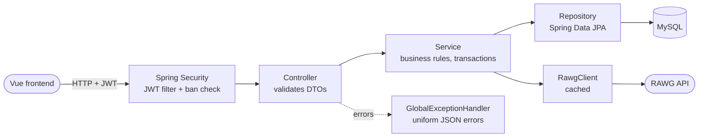
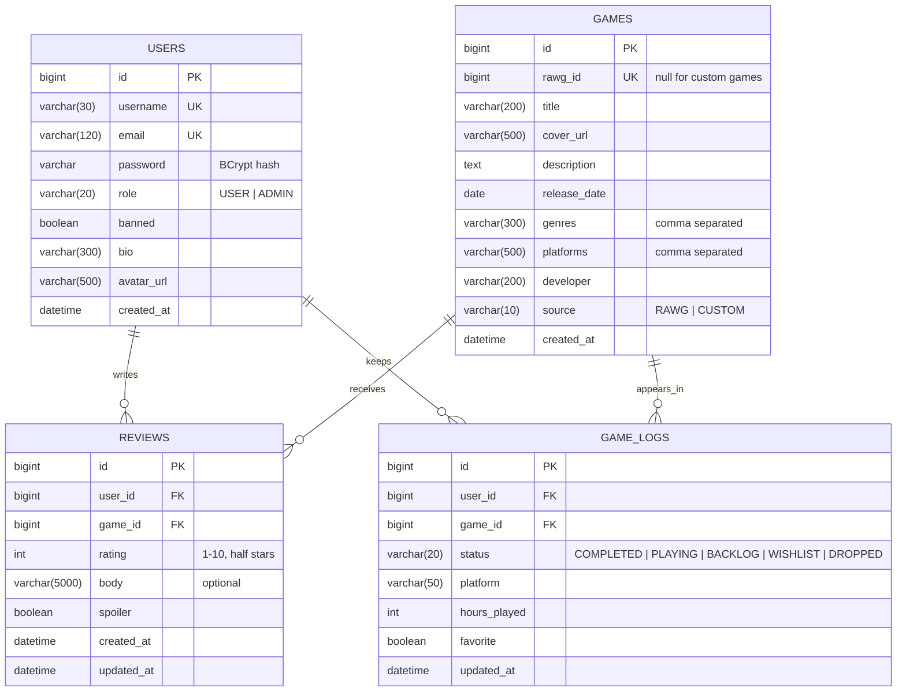
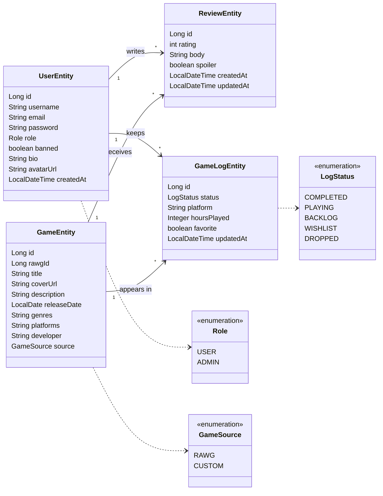
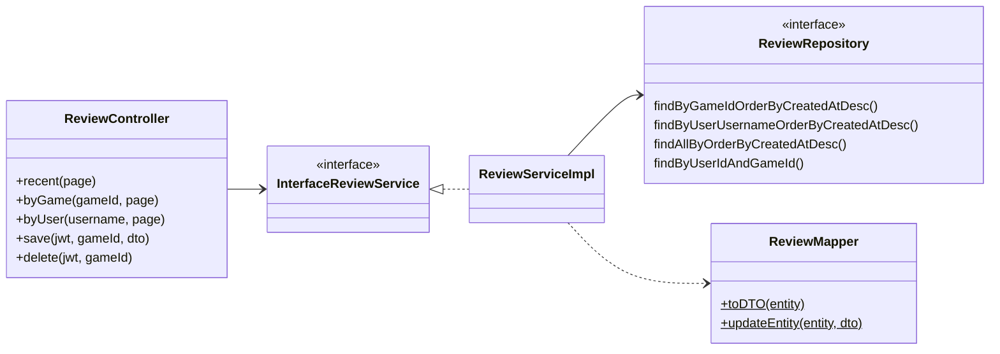

# GameTracker · Backend

REST API for **GameTracker**, a Letterboxd-style diary for video games: log the games you play, rate them with half stars, write reviews and follow what the community is playing.

Built with **Spring Boot 4** and **Java 21**, secured with **Spring Security + JWT**, persisted in **MySQL 8.4 (Docker)** and fed with real game data from the **[RAWG](https://rawg.io) API**.

| | |
|---|---|
| Frontend repository | [joseang1/gametracker-frontend](https://github.com/joseang1/gametracker-frontend) |
| Presentation | _link added before submission_ |
| Project board | JIRA · 3 sprints (backend, frontend, docs & delivery) |

---

## Table of contents

1. [Features](#features)
2. [Tech stack](#tech-stack)
3. [Architecture](#architecture)
4. [Diagrams](#diagrams)
5. [Getting started](#getting-started)
6. [API reference](#api-reference)
7. [Security](#security)
8. [Testing](#testing)
9. [Workflow](#workflow)

---

## Features

| Role | Can do |
|---|---|
| **Guest** | Browse and search the catalog, see trending games, read game pages, reviews and public profiles |
| **User** | Everything a guest can, plus: log games with a status (playing, completed, backlog, wishlist, dropped), platform, hours and favourite; rate (1–10, shown as half stars) and review games with spoiler warnings; edit their profile |
| **Admin** | Everything a user can, plus: site statistics, ban and unban players, delete reviews, create, edit and delete games |

Game data comes from RAWG. The backend **proxies and caches** RAWG, and imports a game into its own database the first time someone opens it, so reviews and logs always point to our own ids.

---

## Tech stack

| Area | Technology |
|---|---|
| Language / framework | Java 21 · Spring Boot 4.1 (Web MVC, Data JPA, Validation, Cache, Actuator) |
| Security | Spring Security · OAuth2 Resource Server (JWT, HS256) · BCrypt |
| Database | MySQL 8.4 in Docker Compose · H2 in-memory profile for quick runs |
| External API | RAWG Video Games Database (Spring `RestClient` + in-memory cache) |
| Tests | JUnit 5 · Mockito · Hamcrest · MockMvc (`@WebMvcTest`) · `@DataJpaTest` · Testcontainers (MySQL) · `MockRestServiceServer` |
| Build | Maven Wrapper |

---

## Architecture

The code is organised **by feature**. Each feature has its own controller, service (interface + implementation), repository, entity, DTOs, mapper and exceptions.

```
com.josedev.gametracker
├── auth       register, login, current user
├── user       profiles, user entity and roles
├── game       catalog, trending, RAWG import, admin CRUD
│   └── rawg   RAWG client and its DTOs
├── review     reviews and ratings
├── gamelog    personal library (status, platform, hours, favourite)
├── admin      statistics and moderation
├── security   JWT creation, ban check, user lookup
├── config     security, JWT, RAWG, seed data
└── globals    global exception handler, base exception, page DTO
```

Every request follows the same path:



- **DTOs as Java records** (`XDTORequest` / `XDTOResponse`) with Jakarta validation. Entities never leave the backend.
- **Static mappers** (`toEntity` / `toDTO`) convert between DTOs and entities.
- **Errors:** each feature throws its own exception extending `ApiException`, which carries an HTTP status. `GlobalExceptionHandler` turns them into `{ status, message, errors, timestamp }`, with one message per invalid field for validation errors.

---

## Diagrams

### Database (ER)



`reviews` and `game_logs` each have a **unique (user_id, game_id)** constraint: one review and one log per game per user. Saving again updates the existing row.

### Domain classes



### Layers of a feature (example: reviews)



---

## Getting started

### Requirements

- **Java 21**
- **Docker Desktop** (for MySQL and for the integration tests)
- A free **RAWG API key**: sign up at [rawg.io/apidocs](https://rawg.io/apidocs)

### 1. Clone and configure

```bash
git clone https://github.com/joseang1/gametracker-backend.git
cd gametracker-backend
cp .env.example .env
```

Open `.env` and paste your key:

```
RAWG_API_KEY=your_key_here
```

`.env` is ignored by git. Spring loads it automatically through `spring.config.import=optional:file:.env[.properties]`.

### 2. Run

**With MySQL (default).** Start Docker Desktop, then:

```bash
./mvnw spring-boot:run
```

Spring Boot's Docker Compose support starts the MySQL container from `compose.yaml` (port **3307**) on its own. You can also run `GametrackerApp.java` from your IDE.

**Without Docker** (in-memory H2, data is lost on restart):

```bash
SPRING_PROFILES_ACTIVE=h2 ./mvnw spring-boot:run
```

The API is then available at **http://localhost:8080/api/v1**.

### Demo accounts

Created on the first start, when the users table is empty:

| Username | Password | Role |
|---|---|---|
| `admin` | `admin1234` | ADMIN |
| `demo` | `demo1234` | USER |

### Configuration

| Variable | Default | Purpose |
|---|---|---|
| `RAWG_API_KEY` | _(empty)_ | RAWG key. Without it, search and trending return empty results |
| `SPRING_PROFILES_ACTIVE` | `mysql` | `mysql` or `h2` |
| `JWT_SECRET` | development key | Base64 secret, 32+ bytes. **Change it outside local development** |
| `CORS_ORIGINS` | `http://localhost:5173` | Allowed frontend origins, comma separated |
| `ADMIN_PASSWORD` / `DEMO_PASSWORD` | `admin1234` / `demo1234` | Passwords for the seeded accounts |

---

## API reference

Base URL: `/api/v1`. 🔓 public · 👤 logged user · 🛡️ admin.

| Method | Endpoint | Access | Description |
|---|---|---|---|
| POST | `/auth/register` | 🔓 | Create an account, returns `{ token, user }` |
| POST | `/auth/login` | 🔓 | Log in, returns `{ token, user }` |
| GET | `/auth/me` | 👤 | Current user |
| GET | `/games?search=&page=` | 🔓 | Search the catalog (RAWG + custom games), 20 per page |
| GET | `/games/trending` | 🔓 | 12 trending games |
| GET | `/games/{id}` | 🔓 | Game details with rating stats |
| GET | `/games/rawg/{rawgId}` | 🔓 | Game details by RAWG id, imported on first visit |
| POST | `/games` | 🛡️ | Create a custom game |
| PUT | `/games/{id}` | 🛡️ | Edit a game |
| DELETE | `/games/{id}` | 🛡️ | Delete a game with its reviews and logs |
| GET | `/games/{gameId}/me` | 👤 | My log and review for a game |
| PUT | `/games/{gameId}/log` | 👤 | Create or update my log |
| DELETE | `/games/{gameId}/log` | 👤 | Remove the game from my library |
| GET | `/games/{gameId}/reviews?page=` | 🔓 | Reviews of a game |
| PUT | `/games/{gameId}/review` | 👤 | Create or update my review |
| DELETE | `/games/{gameId}/review` | 👤 | Delete my review |
| GET | `/reviews?page=` | 🔓 | Most recent reviews |
| GET | `/users/{username}` | 🔓 | Public profile with stats |
| PUT | `/users/me` | 👤 | Edit my bio and avatar |
| GET | `/users/{username}/logs?status=&favorites=&page=` | 🔓 | A user's library |
| GET | `/users/{username}/reviews?page=` | 🔓 | A user's reviews |
| GET | `/admin/stats` | 🛡️ | Site statistics |
| GET | `/admin/users?search=&page=` | 🛡️ | Search players |
| PATCH | `/admin/users/{id}/ban` | 🛡️ | Ban a player (admins cannot be banned) |
| PATCH | `/admin/users/{id}/unban` | 🛡️ | Unban a player |
| GET | `/admin/reviews?page=` | 🛡️ | Reviews to moderate |
| DELETE | `/admin/reviews/{id}` | 🛡️ | Delete any review |

Every error has the same shape:

```json
{ "status": 400, "message": "Validation failed", "errors": { "email": "Email is not valid" }, "timestamp": "..." }
```

---

## Security

- **Stateless JWT.** Login and register return a token signed with **HS256**. The client sends it as `Authorization: Bearer <token>`. It expires after 24 hours.
- **Passwords** are hashed with **BCrypt**.
- **Role rules** live in `SecurityConfig`: reading is public, writing needs an account, moderation needs `ADMIN`.
- **Ban check on every request.** `UserStatusJwtConverter` loads the user from the database for each request, so a banned user is rejected immediately even with a valid token, and the role always comes from the database rather than from the token.
- **CSRF disabled** because there are no cookie sessions. **CORS** only allows the configured frontend origin.

---

## Testing

```bash
./mvnw test
```

**103 tests** in four layers. Docker must be running for the Testcontainers tests.

| Layer | Tools | What it proves |
|---|---|---|
| Unit | JUnit 5 · Mockito · Hamcrest | Service and mapper logic, JWT creation, ban check |
| Web slice | `@WebMvcTest` · MockMvc | Validation, status codes and role rules of every controller, with the real security configuration |
| Repository | `@DataJpaTest` | Custom queries and unique constraints |
| Integration | `@SpringBootTest` · **Testcontainers MySQL 8.4** | A full journey on a real database: admin creates a game → a player registers, logs and reviews it → stats and profile update → admin bans the player (their token stops working, login is refused) and deletes the review → a tampered token is rejected |

The RAWG client is tested with `MockRestServiceServer`, so tests never call the real API.

---

## Workflow

- **Branches:** `main` holds the delivered version. `dev` is the integration branch. Each story is built on its own `feature/`, `fix/`, `test/` or `chore/` branch and merged into `dev` with `--no-ff`.
- **Commits** follow [Conventional Commits](https://www.conventionalcommits.org/) (`feat`, `fix`, `test`, `chore`, `docs`, `refactor`).
- **Planning** in JIRA: epics per feature, stories per screen or endpoint, three sprints.

---

Made by **Jose Ángel Peña Díaz** as the final project of the Factoría F5 · P5 Digital Academy full-stack bootcamp. Game data provided by [RAWG](https://rawg.io).
